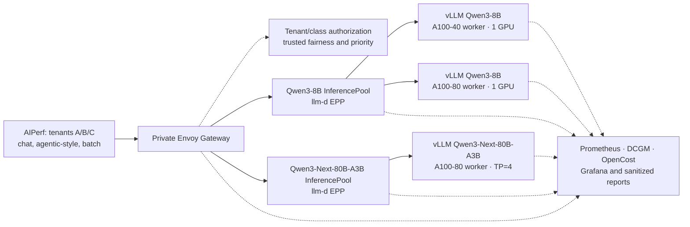

# Kube Inference Platform — implementation and operations guide

Kube Inference Platform is a portable, Kubernetes-native LLM inference platform for
turning bare-metal NVIDIA GPU servers into single- or multi-node inference clusters. The
long-term platform will provide declarative model deployment, topology-aware placement,
distributed execution, routing, autoscaling, SLO management, observability, and cost
optimisation.

> [!IMPORTANT]
> The repository currently contains the v0.1 foundation, portable host preparation,
> single-node Kubernetes bootstrap, NVIDIA GPU stack tooling, and a pluggable runtime layer
> with a vLLM adapter. It also contains the Prometheus/Grafana/DCGM/OpenCost observability
> layer and the AIPerf-based benchmark and report workflow. The host-to-inference path
> and live observability have passed on target NVIDIA A10 hardware. The complete baseline
> benchmark report and cost reconciliation remain pending.

## v0.1 objective

The v0.1 milestone establishes one complete, production-shaped vertical slice:

```text
bare-metal NVIDIA GPU
        ↓
single-node Kubernetes
        ↓
NVIDIA GPU Operator
        ↓
vLLM model server
        ↓
OpenAI-compatible streaming API
        ↓
AIPerf benchmark sweep
        ↓
latency, throughput, GPU telemetry, and cost report
```

The goal is not to build the full control plane. The goal is to prove that a real model can
serve real requests on a real GPU and that the complete request path can be measured.

See [the architecture document](docs/architecture.md) for component boundaries and data
flow.

## Repository layout

```text
.
├── bench/                  AIPerf orchestration and static report generation
├── benchmarks/             Reviewed suites, Kubernetes assets, work data, and reports
├── costs/profiles/         Reviewed whole-node pricing profiles
├── deploy/                 Host, cluster, GPU, runtime, observability, and pilot locks
├── docs/                   Architecture documentation
├── experiments/baseline/   Reproducible baseline experiment record
├── fleet/                  Vast pilot and task-owned Lambda lease/inventory tooling
├── tests/                  Benchmark and deployment-tooling tests
├── Makefile                Local development commands
└── pyproject.toml          Python project and tool configuration
```

Operational instructions remain in this README. A separate runbook will only be introduced
if multi-node operations, upgrades, or recovery procedures make this document unwieldy.

## Local development

### Prerequisites

- Python 3.12 recommended for development (supported range: Python 3.11–3.13)
- [uv](https://docs.astral.sh/uv/)
- Make

Create the development environment:

```bash
make setup
```

`make setup` also prepares the ignored `.cache/artifact-validators/` directory. The explicit
setup helper downloads the Prometheus `3.14.0` release archive, Helm `3.21.4`, and the two
digest-addressed upstream charts, verifies every download against a committed SHA-256, and
installs only `promtool`, `helm`, and the chart archives into that cache. It supports Darwin
and Linux on amd64 and arm64. It never pipes downloaded content to a shell. To populate or
repair only this cache, run:

```bash
make artifact-validator-setup
```

Run all local checks:

```bash
make check
```

`make check` validates Python and Bash, dashboard/profile structure, Prometheus rule
structure, Helm values, and the Git-eligible tree for raw benchmark data or credentials.
It is fail-closed: the pinned `promtool` must accept every rule and the pinned Helm binary must
lint and render both exact, checksum-verified upstream chart archives. The check never
downloads missing dependencies and fails with the cache-setup command instead of silently
skipping semantic validation. `artifact-acceptance-check` remains a compatibility alias for
the same strict gate.

CI may cache `.cache/artifact-validators/` using the validator checksum manifest plus the
cluster and observability version manifests as its cache key. A caller may instead provide
pre-cached artifacts explicitly; the validator still enforces the pinned tool versions and
chart checksums:

```bash
make artifact-check \
  PROMTOOL=/path/to/promtool \
  HELM=/path/to/helm \
  KUBE_PROMETHEUS_STACK_CHART_ARCHIVE=/path/to/kube-prometheus-stack-91.4.0.tgz \
  OPENCOST_CHART_ARCHIVE=/path/to/opencost-2.5.30.tgz
```

For edit-time feedback when downloads are intentionally unavailable,
`make artifact-structural-check` runs only the local schema, syntax, and sanitization subset.
It is not an acceptance gate and is never used by `make check`.

Inspect the benchmark platform commands:

```bash
make benchmark-help
```

The Python package validates reviewed suites, starts AIPerf Kubernetes jobs, normalizes AIPerf
results, queries Prometheus and OpenCost, and renders reports. It does not implement a second
HTTP load generator or recalculate AIPerf's request-level latency metrics.

## Host preparation

The v0.1 host tooling runs directly on a target machine rather than orchestrating it remotely.
From a repository checkout on the host, run:

```bash
make host-setup
```

On a minimal image where `make` is not installed yet, invoke the underlying setup once; it
installs `make` along with the inspection prerequisites, after which the public Make targets
are available:

```bash
./deploy/host/setup.sh
```

The setup command installs only missing inspection prerequisites and then validates the host.
It supports root execution or a non-root user with `sudo`, and it is safe to repeat. It does
not install or configure containerd, Kubernetes, NVIDIA software, swap, kernel modules,
sysctls, or networking.

The v0.1 target contract is:

- Ubuntu 22.04 or 24.04
- x86-64
- systemd
- `apt` package management
- Root access or working `sudo`
- A usable non-loopback network interface

Run validation without changing the host:

```bash
make host-check
```

Display the complete output from hardware inspection commands:

```bash
make host-check VERBOSE=1
```

Before GPU Operator installation, unavailable NVIDIA hardware and driver checks are reported
as `DEFERRED`. `GPU_REQUIRED=1` is the strict host-level check for the explicit
preinstalled-driver workflow:

```bash
make host-check GPU_REQUIRED=1
```

Operator-managed drivers live in the Operator's host-mounted driver root, so Kubernetes-level
`gpu-check` and `gpu-smoke` are authoritative for the default Operator-managed workflow.

Both `VERBOSE` and `GPU_REQUIRED` accept only `0` or `1`. Terminal colors are enabled only for
interactive output and can be disabled explicitly with `NO_COLOR=1`. Host details are printed
to the terminal and are never persisted automatically.

The later multi-node milestone will add inventory-driven remote orchestration while reusing
these same target-local scripts.

## Single-node Kubernetes bootstrap

After host preparation, bootstrap Kubernetes directly on the target:

```bash
make cluster-bootstrap
```

The v0.1 cluster is pinned to Kubernetes 1.36.4, containerd 2.3.4, Cilium 1.20.1,
Cilium CLI 0.19.7, and Helm 3.21.4. The node runs both the control-plane and worker roles;
kube-proxy remains enabled, and Cilium uses Kubernetes PodCIDR IPAM with an IPv4 VXLAN
overlay. Hubble remains outside v0.1; Cilium metrics are enabled without it.

The default network ranges are:

```text
Pod CIDR:      10.244.0.0/16
Service CIDR:  10.96.0.0/12
DNS domain:    cluster.local
```

The bootstrap derives the node IPv4 address from a single default route. Specify it when the
host has multiple default routes, and override network ranges when they conflict with target
host or provider routes:

```bash
make cluster-bootstrap NODE_IP=192.0.2.10
make cluster-bootstrap POD_CIDR=172.20.0.0/16 SERVICE_CIDR=172.21.0.0/16
```

The command makes the following persistent host changes:

- Installs only the pinned container runtime and Kubernetes tooling, plus verified Helm and
  Cilium CLI binaries. It never performs a package upgrade or installs Docker Engine.
- Loads `overlay` and `br_netfilter`, enables bridge packet filtering and IPv4 forwarding,
  and writes project-owned files under `/etc/modules-load.d` and `/etc/sysctl.d`.
- Disables swap and creates `/etc/fstab.kip-pre-bootstrap` before marking swap entries in
  `/etc/fstab`. Swap managed outside that file is rejected instead of changed blindly.
- Writes the containerd and `crictl` configuration, initializes kubeadm, installs Cilium,
  and copies the administrative kubeconfig to the invoking user's `~/.kube/config` with
  restrictive permissions.

Between `kubeadm init` and Cilium installation, a `NotReady` node and pending CoreDNS pods are
expected transitional states. Completion is reported only after containerd, kubelet, the API
readiness endpoint, all control-plane components, kube-proxy, Cilium, CoreDNS, DNS resolution,
Service routing, and Cilium connectivity pass.

Re-running the command reconciles a healthy matching cluster and reruns smoke tests. It stops
on partial kubeadm state, version drift, changed immutable CIDRs, or an unrelated existing
runtime. It never runs `kubeadm reset` or deletes etcd data automatically.

Run read-only validation at any time:

```bash
make cluster-check
make cluster-check VERBOSE=1
```

The validator reads current services and cluster resources but creates no pods and writes no
report. The mutating DNS, Service, and Cilium connectivity smoke tests run only during
`cluster-bootstrap`.

Normal administration remains inside the SSH session on the target. The bootstrap does not
disable the host firewall or open NodePort ranges. If remote API access is enabled, restrict
TCP 6443 to trusted administrator addresses in both the provider and host firewalls. Treat
`~/.kube/config` and `/etc/kubernetes/admin.conf` as administrative credentials and never
commit or print them.

## NVIDIA GPU stack

After `make cluster-bootstrap` passes, install the GPU stack directly on the target:

```bash
make gpu-install
```

The default `GPU_DRIVER_MODE=operator` lets GPU Operator install the pinned NVIDIA driver. A
machine with a provider-installed driver must opt into the alternate mode, and its host
`nvidia-smi` and topology checks must pass before the cluster is changed:

```bash
make host-check GPU_REQUIRED=1
make gpu-install GPU_DRIVER_MODE=preinstalled
```

Operator-managed mode also requires the exact running-kernel header package to remain
downloadable from the configured Ubuntu repositories. This is stricter than merely having
headers installed on the host because the driver container resolves its own build packages.
If an image boots an obsolete kernel whose headers have left the repositories, update the
kernel and reboot the target before running `make gpu-install`; the tooling never reboots it.

The v0.1 stack pins GPU Operator v26.7.0 and driver 595.91.07. Before Helm runs, the installer
downloads Cosign into a temporary directory, checks its pinned checksum, confirms that the
chart tag resolves to the committed OCI digest, and verifies NVIDIA's signature. Helm then
installs that immutable chart digest as release `gpu-operator` in namespace `gpu-operator`.
The selected driver mode and digest are stored in the release values.

CDI is enabled, NRI is disabled, and ordinary Pods request the standard `nvidia.com/gpu`
resource without a `runtimeClassName`. The NVIDIA toolkit writes its containerd drop-in under
`/etc/containerd/conf.d`, which is already imported by the project-owned containerd
configuration. Node Feature Discovery, the toolkit, Device Plugin, GPU Feature Discovery, and
validators are enabled for the GPU checkpoint. DCGM Exporter remains disabled until
`observability-install`, which safely reconciles the existing exact GPU Operator release to
enable the digest-pinned exporter at a one-second collection interval. GPU Operator retains
ownership of that workload in `gpu-operator`; observability owns only its ServiceMonitor and
metric contract. A later `gpu-install` rerun preserves the enabled exporter. MIG, time-slicing,
DRA, and all other shared or partitioned allocation modes are disabled.

The installer is deliberately a hard checkpoint. It requires Operator and operand health,
requires Kubernetes capacity and allocatable `nvidia.com/gpu` to match the physical PCI GPU
count, and runs a temporary Pod that requests one GPU and executes `nvidia-smi`. The Pod is
deleted on success or failure, and cluster health is checked again. Do not proceed to vLLM
unless the command completes successfully.

Run read-only validation or repeat only the temporary workload independently:

```bash
make gpu-check
make gpu-check VERBOSE=1
make gpu-smoke
make gpu-smoke VERBOSE=1
```

Safe reruns reconcile only the same release, namespace, chart version and digest, driver mode,
and v0.1 values. Version, mode, allocation, or unmanaged-installation drift stops with
diagnostics; it is never adopted or upgraded automatically. A failed Helm installation is
not rolled back automatically so its Pods remain available for inspection. The tooling never
uninstalls a host driver, unloads kernel modules, deletes NVIDIA CRDs, edits GRUB, blacklists
modules, resets GPUs, repairs Secure Boot, or reboots the machine.

GPU details remain terminal-only. Treat kubeconfig access and all registry credentials as
sensitive, keep TCP 6443 restricted, and use `VERBOSE=1` only where terminal output is handled
appropriately.

## vLLM runtime checkpoint

After the GPU hard checkpoint passes, deploy the committed runtime and model profile:

```bash
make runtime-deploy
```

The public `runtime-*` interface dispatches to a runtime-specific adapter. v0.1 allowlists only
`RUNTIME=vllm` with `MODEL_PROFILE=qwen2.5-7b-instruct`; arbitrary images, models, resource
overrides, and engine arguments are rejected. The profile pins Qwen2.5-7B-Instruct at revision
`a09a35458c702b33eeacc393d103063234e8bc28`, the served name
`qwen2.5-7b-instruct`, and the immutable Linux/amd64 CUDA 12.9 vLLM v0.29.0 image.

The baseline runs one BF16 replica on one whole GPU with tensor parallelism `1`, an 8,192-token
maximum model length, GPU memory utilization `0.90`, at most eight sequences, and seed `0`.
It deliberately avoids quantization, CPU offload, speculative decoding, remote model code,
and distributed execution. The Pod requests 4 CPU, 24 GiB memory, 10 GiB ephemeral storage,
and one GPU; limits are 12 CPU, 48 GiB memory, 20 GiB ephemeral storage, and one GPU. A
memory-backed 4 GiB `/dev/shm`, restrictive container security context, and health probes are
included.

The first deployment may spend substantial time pulling the vLLM image and downloading the
approximately 15.2 GB model before probes become healthy. The installer permits a 45-minute
rollout and requires either 60 GiB free when the model cache and containerd share a filesystem,
or 25 GiB for the cache plus 30 GiB for containerd when they are separate. Model files persist
across Pod restarts and matching redeployments under:

```text
/var/lib/kube-inference-platform/model-cache/vllm
```

The baseline model is public and requires no Hugging Face credential. A future committed
profile may name a Secret in `kip-runtime`; that Secret must contain a `token` key. The tooling
checks only for the key and never reads or prints its value.

The Service is deliberately internal-only (`ClusterIP`) on port 8000. For manual inspection
from the target, start a local tunnel:

```bash
kubectl -n kip-runtime port-forward service/vllm-qwen25-7b 8000:8000
curl --fail http://127.0.0.1:8000/health
curl --fail http://127.0.0.1:8000/v1/models
```

The same port exposes `/metrics`. The Deployment and Pod template carry stable runtime,
deployment, model-profile, served-model, model-revision, worker-role, replica, and rank labels.
The Service carries only routing/discovery identity; Prometheus copies worker identity from
the backing Pod, so a shared Service cannot assign one worker's role or rank to every target.
The current single-process replica is labelled `worker-role=combined`; future router, prefill,
and decode workers can use the same contract without changing dashboards.

Read-only validation checks the pinned profile, image, model revision, ownership, Deployment,
Pod, Service endpoint, `/health`, and `/v1/models` without creating resources or generating
tokens:

```bash
make runtime-check
make runtime-check VERBOSE=1
```

The inference checkpoint creates a temporary in-cluster client Pod and ConfigMap, then removes
both on success, failure, or interruption:

```bash
make runtime-smoke
make runtime-smoke VERBOSE=1
```

It verifies health, exact model discovery, non-streaming chat and legacy completions, and
streaming chat SSE. Streaming must contain at least eight non-empty content deltas, finish with
`[DONE]`, and span at least 100 ms between the first and last content arrival so a buffered
response cannot pass. Cluster and GPU validation run again after inference.

Safe reruns reapply only an exact managed installation and repeat all validation. Profile,
image, model, ownership, or active-runtime drift is refused rather than adopted. The
`Recreate` Deployment strategy prevents an old full-GPU Pod from blocking its replacement.
On failure, inspect the printed Deployment, Pod, log, and event diagnostics; `VERBOSE=1` adds
successful command details without writing response bodies or traces to disk.

## Observability and cost accounting

Install the internal observability stack after the runtime checkpoint:

```bash
make observability-install
make observability-install COST_PROFILE=<reviewed-profile>
make observability-install VERBOSE=1 COST_PROFILE=a10-node
make observability-check
make observability-smoke
```

The stack combines Prometheus, Grafana, Alertmanager, kube-state-metrics, node-exporter, and
the OpenCost API/exporter in `kip-observability`. Installation accepts only the exact
KIP-managed GPU Operator chart, digest, driver mode, and baseline values before enabling its
pinned DCGM Exporter; unmanaged or drifted releases fail before that Helm mutation. The GPU
Operator continues to own the exporter in `gpu-operator`, while observability owns the scraper
and metric contract. A checksum-pinned collector ConfigMap enables the GPU utilization,
memory, power, temperature, clock, PCIe, throttle-reason, and XID counters used by the stable
rules. Validation checks the effective ClusterPolicy and generated exporter DaemonSet—not only
Helm's stored values—and a missing ConfigMap is safely restored before GPU health is evaluated.
DCGM PCIe throughput profiling is hardware-dependent: when the GPU does not expose those
series, the PCIe panel has no data and benchmark reports show `N/A` with a data-quality warning.
The required utilization, memory, power, temperature, and inference metrics still gate success.
Unmanaged content or live image/environment drift is refused. Services remain `ClusterIP`;
the installer creates no ingress, NodePort,
or external load balancer. Prometheus
keeps up to 15 days or 20 GB of samples, and project-owned local volumes reserve 30 GiB for
Prometheus and 2 GiB each for Grafana and Alertmanager. Its 60-GiB free-space gate also leaves
room for the separate 20-GiB benchmark PV created later by `benchmark-install`.

The collection contract favours useful inference resolution without turning every exporter
into a high-cardinality trace store:

- vLLM and DCGM are scraped every 5 seconds; DCGM samples GPU state every second.
- Kubernetes, node, Cilium, and OpenCost data are scraped every 15–30 seconds.
- Prometheus rules evaluate every 15 seconds; OpenCost inference attribution evaluates each
  minute.
- AIPerf additionally records benchmark-local server and GPU telemetry every 333 milliseconds
  only while a benchmark is active.

`observability-check` is read-only. `observability-smoke` briefly runs the existing runtime
smoke client to seed request, token, and latency series, cleans up those temporary resources,
then requires every dashboard metric family and scrape target to be queryable.

Raw engine and exporter metrics are adapted into stable `kip:` recording rules. Their common
dimensions cover cluster, namespace, Deployment, runtime, model profile, served model,
worker role, Pod, node, and GPU UUID. This is why the current one-model Deployment is labelled
as a `combined` worker: the same dashboards can later compare routers, prefill workers, decode
workers, replicas, and ranks instead of encoding today's topology into every query.

Grafana provisions fleet, model-serving, GPU/node, distributed-topology, benchmark, and
cost/efficiency dashboards. Active alerts cover missing collectors, runtime availability,
request errors, queue and KV-cache pressure, GPU temperature/memory/XID events, storage, and
stale cost data. Latency SLOs and budget thresholds are templates until the baseline provides
defensible thresholds.

List the internal services before opening a local-only tunnel:

```bash
kubectl -n kip-observability get services
kubectl -n kip-observability port-forward service/kip-monitoring-grafana 3000:80
kubectl -n kip-observability port-forward service/kip-monitoring-prometheus 9090:9090
kubectl -n kip-observability port-forward service/kip-monitoring-alertmanager 9093:9093
kubectl -n kip-observability port-forward service/kip-opencost 9003:9003
```

Do not bind these port-forwards to a public interface. Retrieve the generated Grafana
credential only when it is needed:

```bash
kubectl -n kip-observability get secret kip-grafana-admin \
  -o go-template='{{index .data "admin-user" | base64decode}}{{"\n"}}'
kubectl -n kip-observability get secret kip-grafana-admin \
  -o go-template='{{index .data "admin-password" | base64decode}}{{"\n"}}'
```

The password is never included in ordinary installer output. Treat it and the administrative
kubeconfig as credentials.

### Whole-node pricing

OpenCost provides the Kubernetes allocation and inference-cost views, while reviewed profiles
under `costs/profiles/` provide the actual machine price. Configure and inspect one with:

```bash
make cost-configure COST_PROFILE=a10-node
make cost-check
make cost-show
```

Create `costs/profiles/a10-node.json` from the committed
`costs/profiles/a10-node.template.json`, replace every placeholder with public pricing
metadata, and then use `COST_PROFILE=a10-node`. Template files are never accepted as active
pricing.

A v0.1 profile records a positive USD whole-node hourly rate, provider/SKU, region, pricing
source, effective date, expected physical GPU count, and a declaration that electricity is
already included. Its canonical SHA-256 is stored with benchmark metadata. The repository
ships an unpriced A10 template but deliberately does not invent a provider rate.

For the current dedicated-node model, the node rate is divided by the physical GPU count and
assigned as the OpenCost GPU rate; CPU, RAM, storage, network, and load-balancer rates are zero
to avoid counting the same rental twice. The primary **allocated** view includes node-local
idle cost and reconciles to the server bill. The secondary **usage** view isolates active
resource consumption and is an efficiency indicator, not an invoice. DCGM power integration
adds Wh/request and kWh/million-token measurements, but no electricity charge is added because
it is already part of the rental rate.

Observability can run without pricing; dashboards then display `Pricing not configured`, and
`cost-check` reports a warning. Benchmark publication is stricter: it requires a current,
valid profile and refuses to emit zero or misleading costs. Cost figures are transparent
rate-based estimates rather than provider invoices, and no billing credential is used.

## AIPerf benchmark and report workflow

The platform uses AIPerf 0.12 for traffic generation and request metrics. KIP owns the
reviewed suite, Kubernetes orchestration, result normalization, Prometheus/OpenCost queries,
sanitization, and static report; it does not maintain a competing asynchronous HTTP client.
AIPerf 0.12 does not publish the proposed Kubernetes operator or CRDs, so v0.1 places an
executor boundary around an ownership-safe ordinary Kubernetes Job. A later operator backend
can replace that executor without changing suites or reports.

Prepare the local benchmark environment and install its scoped Kubernetes foundation:

```bash
make benchmark-setup
make benchmark-install
make benchmark-check
make benchmark-help
```

Installation creates the `kip-benchmark` namespace, scoped ServiceAccount, contract ConfigMap,
and a 20-GiB PV/PVC backed by
`/var/lib/kube-inference-platform/benchmark-results`. It uses `sudo` once when necessary to
create that fixed project-owned path as UID/GID `1000` with mode `0770`; no arbitrary storage
path is accepted. Ephemeral CPU-only Jobs run the digest-pinned `aiperf profile` once for the
warmup and for each trial/cell, request no GPU, and write only into that results volume.
Ownership checks prevent the executor from adopting or replacing unrelated Jobs or storage.

For a short end-to-end checkpoint, the reviewed `smoke` suite runs an eight-request warmup
followed by 300 measured streaming requests at each concurrency of `1` and `4`. This keeps
both measured cells longer than OpenCost's minute-scale allocation window on the validated
node and spans multiple five-second Prometheus scrapes:

```bash
make benchmark SUITE=smoke COST_PROFILE=<reviewed-profile>
```

Run the reviewed baseline only after cluster, GPU, runtime, observability, and cost checks pass:

```bash
make benchmark SUITE=baseline COST_PROFILE=a10-node
```

The baseline fixes the model, prompt distribution, 512-token input target, 128-token output
target, streaming mode, temperature `0`, seed `42`, and `ignore_eos`. It excludes a 100-request
warmup, then runs 1,000 measured requests at concurrency `1`, `4`, `8`, `16`, and `32` across
five independent trials, with a 30-second cooldown between trials. That is 25,000 measured
requests. Every warmup, trial, cell, cooldown, and experiment boundary is recorded in UTC.
The runner freezes the starting Git commit, clean/dirty state, and a deterministic workspace
SHA-256 before generating load; reports therefore remain tied to the exact reviewed or locally
modified source state even when the benchmark lasts several hours. It also freezes component,
runtime image/profile/model, GPU, and serving-Pod identity. Publication is refused if the source
tree, serving Pod UID, restart count, or platform identity changes during the sweep.
The six-hour suite timeout is applied independently to each AIPerf cell, since the reviewed
25-trial matrix intentionally takes longer than six hours when executed sequentially. If the
target-local orchestrator is interrupted, resume it with:

```bash
make benchmark-resume RUN_ID=<run-id> SUITE=baseline COST_PROFILE=a10-node
```

Resume is refused unless the frozen plan, suite and cost hashes, completed-cell prefix,
AIPerf summaries, benchmark foundation, and serving-platform identity all still match. Partial
output for the first missing cell is preserved with a `.failed-<UTC>` suffix before that cell is
retried. Published data-quality notes identify resumed experiments.

AIPerf runs with `--export-level summary`: raw prompts, responses, and request records are not
exported. Each successful cell is compressed to `<cell>.tar.gz` on the node before its summary
is copied into the ignored `benchmarks/.work/<run-id>/` normalization workspace. A successful
report writes only sanitized artifacts to `benchmarks/reports/<run-id>/`:

```text
index.html
summary.json
summary.csv
reproducibility.json
charts/*.svg
```

The report combines AIPerf latency and throughput with model-scoped Prometheus runtime/GPU
telemetry and OpenCost allocation. Runtime gauges use stable rules; short-trial GPU gauges use
raw five-second DCGM samples joined to the runtime Pod identity, avoiding the lag of two
15-second recording-rule stages. Samples are clipped to each trial's exact UTC
boundaries; token rates and server latency percentiles are recomputed from raw counter and
histogram increases over that trial, so five-minute dashboard windows cannot mix warmup,
cooldown, or neighboring concurrency cells into the result. It keeps AIPerf's client-observed
TTFT, inter-token latency (ITL), and end-to-end latency distinct from vLLM's server-observed
TTFT, time per output token (TPOT), and end-to-end latency. It also includes request/output-token
throughput, confidence intervals, trial variability,
running/queued requests, KV-cache state, prompt/generated/cached token rates, server-side
latency, GPU utilization, memory, power, temperature, PCIe traffic when available, clocks, throttle reasons,
XID state, total experiment cost, measured-window cost, per-trial cost, allocated and usage
USD/request,
input/output/blended USD per million tokens, requests/USD, tokens/USD, and energy efficiency.
Exact Grafana links point to each experiment window; static charts are generated without
Grafana Image Renderer.

The summary report calls its streaming claim **streaming timing evidence**: successful/error
request accounting must reconcile, AIPerf must record streaming mode, and the non-cancelled run
must contain positive TTFT and ITL percentiles. ITL measures the arrival gap observed by the
client and is not presented as server TPOT. Summary-only AIPerf artifacts do not retain SSE frames and
therefore cannot prove terminal `[DONE]` framing. `make runtime-smoke` remains the explicit
incremental-SSE and `[DONE]` protocol checkpoint.

Per-trial allocated cost uses `node hourly rate × exact trial duration × OpenCost model share`;
OpenCost's usage and input/output proportions split that amount. This keeps short benchmark
cells from inheriting OpenCost's coarse sub-minute totals while preserving its workload
attribution. The report audits the whole experiment against `node hourly rate × elapsed time` and requires
OpenCost allocation to agree within the greater of 5% or one minute of node cost. Missing
cost/token attribution, stale pricing, a stale post-run scrape, or a larger mismatch invalidates
publication. Publication waits up to three minutes for Prometheus and OpenCost to cover the
completed experiment window instead of publishing partial last-trial data.

Inspect and manage local results with:

```bash
make benchmark-list
make benchmark-report RUN_ID=<run-id>
make benchmark-serve RUN_ID=<run-id>
make benchmark-clean RETAIN_DAYS=30
```

`benchmark-clean` prunes validated run directories from both `.work/` and the node-local result
path after the selected retention period; it never removes published reports or the shared
tokenizer cache. Successful Job/receipt resources are removed immediately. A failed Job is
kept for Kubernetes inspection for up to six hours while logs, `describe`, events, and status
are copied into the ignored work directory; `destroy` removes any remaining benchmark state.

The report server binds to `127.0.0.1` by default. Only the sanitized report is eligible for
version control; never copy files from `.work/` into a report.

## Complete v0.1 bootstrap

Once a host has the required Ubuntu/kernel/network prerequisites plus Python 3.11–3.13, `uv`,
and Make in the target checkout, the composed entry point is:

```bash
make bootstrap COST_PROFILE=a10-node
```

It runs `host-setup → cluster-bootstrap → gpu-install → runtime-deploy →
observability-install → benchmark-install`. It installs benchmarking capability but does not
start the 25,000-request experiment. Omitting `COST_PROFILE` leaves a healthy but explicitly
unpriced stack; a later benchmark remains blocked until pricing is configured.

## Platform teardown

To return a target to the pre-cluster state for a fresh bootstrap, run:

```bash
make destroy
```

The interactive command requires typing `destroy`. For an explicitly authorized
non-interactive run, use:

```bash
make destroy CONFIRM_DESTROY=1
```

Teardown first verifies KIP ownership markers and pinned component identities. It removes
owned benchmark Jobs/foundation state and local generated work data, then OpenCost,
observability resources and their local volumes. Helm-retained Prometheus Operator CRDs are
deleted only when every CRD carries KIP ownership and the exact chart-digest annotation. The
managed runtime namespace and matching GPU Operator are removed next. Committed cost profiles
and sanitized benchmark reports are preserved. It keeps Cilium alive while `kubeadm reset`
stops remaining Pod sandboxes, then
removes Cilium namespaces, interfaces, CNI binaries, pinned BPF objects, and only firewall
rules in `CILIUM_` or `KUBE-` chains. Finally it unmounts project runtime mounts, removes the
node-local model cache, KIP cluster/runtime data, and pinned Kubernetes/containerd packages,
restores the original `fstab`, and removes project-owned sysctl and modules-load files. A
matching user kubeconfig is removed; a changed kubeconfig is preserved. A project-owned
teardown marker makes interrupted runs safely resumable.

The command deliberately preserves SSH access, the operating system, kernel packages,
inspection prerequisites installed by `host-setup`, and shared Helm/Cilium CLI binaries. It
does not unload GPU kernel modules or reboot the target. Unrecognized ownership, an unmanaged
GPU Operator release, or package-version drift causes teardown to stop instead of deleting
state blindly. After a successful teardown, start again with:

```bash
make host-setup
make cluster-bootstrap
make gpu-install
make runtime-deploy
make observability-install COST_PROFILE=a10-node
make benchmark-install
```

## v0.1 implementation milestones

- [x] Create the repository foundation and runnable benchmark skeleton.
- [x] Implement portable host preparation and validation tooling.
- [x] Implement single-node Kubernetes bootstrap and CNI installation tooling.
- [x] Bootstrap and validate the single-node cluster on target hardware.
- [x] Implement NVIDIA GPU Operator installation and CUDA validation tooling.
- [x] Validate the NVIDIA GPU stack and CUDA smoke Pod on target hardware.
- [x] Provision the target host and validate the host, cluster, and GPU slices.
- [x] Implement the pluggable runtime layer and vLLM inference-checkpoint tooling.
- [x] Validate vLLM and streaming OpenAI-compatible inference on target hardware.
- [x] Implement Prometheus, Grafana, DCGM, and stable inference-metric tooling.
- [x] Validate observability collection and dashboards on target hardware.
- [x] Implement OpenCost integration and reviewed whole-node cost profiles.
- [x] Confirm the Vast RTX 4090 node price and reconcile a priced AIPerf smoke report.
- [x] Implement the AIPerf benchmark orchestration and static report tooling.
- [x] Run and publish the short, two-concurrency benchmark on target hardware.
- [ ] Run and document the five-trial baseline concurrency experiment.

Deployment assets are added in that order. Each command documented here must be verified on
the real machine before its checklist item is marked complete.

## Security and local state

Never commit SSH keys, API tokens, kubeconfig files, real machine inventories, model-provider
credentials, or Kubernetes Secret values. Use local ignored files and environment variables,
and commit only clearly marked examples with placeholder values.

Raw benchmark traces, prompts, model responses, Job diagnostics, and model caches remain
local. Sanitized HTML, SVG, CSV, JSON summaries, and reproducibility metadata may be committed
with the reviewed suite and cost profile that produced them. Published cost profiles contain
only public rates and provenance—never billing API keys or account identifiers.

## v0.1 Definition of Done

The v0.1 milestone is complete when a real model runs on a real NVIDIA GPU inside bare-metal
Kubernetes, serves streaming OpenAI-compatible requests, and can be concurrently benchmarked
while application, GPU, energy, and cost telemetry are collected into a reproducible sanitized
report whose allocated cost reconciles with the configured node price.

The Go operator, custom gateway, authentication, rate limiting, autoscaling, multi-replica
routing, and multi-node inference are deliberately deferred until this baseline is proven.

## Multi-tenant llm-d pilot (in progress)

The separate pilot does not change the v0.1 `bootstrap` and `destroy`
contracts. The reviewed synthetic workload and **proposed**, not yet accepted, SLOs live in
[`benchmarks/workloads/pilot-v1.json`](benchmarks/workloads/pilot-v1.json), with precise
measurement boundaries in its adjacent README. `make workload-validate` checks the schema;
`make workload-preview TENANT=tenant-a CLASS=chat TRIAL=1` prints deterministic **metadata**,
not request content. `make workload-generate TENANT=tenant-a WORKLOAD_CLASS=chat TRIAL=1
SESSIONS=4 RATE=0.8` writes a deterministic, ignored, mode-0600 AIPerf dataset and
manifest. The input rate is synthetic session arrivals per second, not a verified
capacity rating. `make campaign-text-replay` then sends the previously generated trace
through the private Gateway using AIPerf 0.12 and the corresponding protected synthetic
tenant key; it requires HTTP 200 and exactly one final SSE `[DONE]` per planned turn.
Raw exports contain request headers and are intentionally ignored: do not publish or
share anything under `benchmarks/.work/`.

The offline request-accounting validator in `bench/pilot_accounting.py` keeps offered,
sent, admitted, queued, dispatched, completed, rejected, failed, and in-flight counts
separate. After a replay, `make campaign-accounting RUN_ID=<run-id>
TENANT=tenant-a WORKLOAD_CLASS=chat` joins private AIPerf correlation IDs to the
Gateway and llm-d endpoint-picker logs, checks upstream worker attribution, and fails
if lifecycle or stream-completion evidence is missing. Its output contains aggregate
counts only. The Gateway's access log records request IDs, status, upstream, and timing,
not credentials, prompt bodies, or responses.

`make fleet-compat-check` validates the separate immutable pilot artifact lock in
[`deploy/fleet/versions.json`](deploy/fleet/versions.json). Its status is
`artifact-locked-target-unvalidated`: image/chart digests have been recorded. The pinned
vLLM 0.30 CUDA 13 image passed a CUDA tensor smoke check on an RTX 4090 with driver
580.178.04 and GPU Operator 26.7.0. The private Envoy AI Gateway/llm-d v0.10 path
has subsequently passed live authenticated streaming and two-worker routing tests on
the heterogeneous three-node pilot. The v0.1 version pins remain unchanged.

`make fleet-plan` makes only read-only Vast account and offer requests. By default it
requires matching GPU workers on distinct hosts in one region. With explicit approval,
`make fleet-plan FLEET_ALLOW_MIXED=1` permits heterogeneous or cross-region candidates;
that is a *candidate search*, not a network-performance or compatibility acceptance. The
plan fails closed if available credit cannot cover eight hours of the first worker plus the
$5 reserve, the proposed active rate exceeds $4/hour, or no eligible three-node offer set
exists. It reports the additional credit required to restore a $50 balance; a full pilot is
not promised on the first-worker allowance. Marketplace prices are
not treated as billed quotes. A changing public VM endpoint is a documented network risk,
not a substitute for the required stable private WireGuard API name; it must pass live
reconnect and route checks before join. Keep the API key in ignored `.secrets/vast-api-key`
with mode `0600`; the planner never prints it. `make fleet-check` inspects a task-owned ignored
`fleet/.work/pilot.json` and is read-only.

`make fleet-first-worker-up` and `make fleet-first-worker-down CONFIRM_DESTROY=1` manage
only an exactly labeled, lease-recorded Vast Ubuntu VM. The first GPU worker has passed
host, Kubernetes, GPU, vLLM, observability, cost, and AIPerf smoke checkpoints on an
RTX 4090. Its sanitized hardware-matched single-GPU control report is
[`benchmarks/reports/pilot-control-20261012-r580/index.html`](benchmarks/reports/pilot-control-20261012-r580/index.html).
This run uses the existing v0.1 vLLM 0.29 runtime, so it is hardware-matched but not a
software-matched llm-d/vLLM 0.30 comparison. It does not represent multi-tenant traffic.

The now-released task-owned three-node pilot had one non-HA control plane and two
RTX 4090 workers on distinct, cross-region hosts connected by a private WireGuard
mesh. Two replicas served the same pinned Qwen revision through `make llmd-install`
and the internal Gateway; twelve credential/class combinations were enforced by a
fail-closed tenant authorization service. `make fleet-check` is read-only and must
run on the control plane or with its private kubeconfig when the fleet is recreated.
The Prometheus/Grafana/DCGM/OpenCost overlay included fleet routing and per-node
cost views. Verified Vast node rates, not marketplace estimates, supplied the
infrastructure audit ledger.

An initial simultaneous A/B/C text smoke completed 46/46 turns, reconciled every
request through AIPerf, Gateway, and endpoint-picker evidence, and reached both GPU
workers. Its [sanitized partial report](benchmarks/reports/pilot-text-20261013-012123/index.html)
records the exact UTC windows, telemetry, and a node-cost reconciliation. It is
explicitly **not** an accepted campaign result: the sample is below 100 turns per
class/trial, chat P95 TTFT missed the proposed 1.5-second SLO, and no voice,
noisy-tenant, worker-failure, rebuild, or confidence-interval trials have run.
`make campaign-report RUN_ID=<run-id>` publishes the reviewed three-tenant text
scenario by default, or the reviewed isolated chat calibration with
`SCENARIO=pilot-chat-calibration` or nine-cohort smoke with
`SCENARIO=pilot-nine-cohort-smoke`. It requires complete private accounting,
the exact live EPP policy hash and pre-run Pod creation time, and a passing
exact-window OpenCost check. The owned EPP Deployment is rolled only when its
reviewed config hash changes; an exact `make llmd-install` rerun leaves it intact.

The [100-plus-sample mixed text trial](benchmarks/reports/pilot-text-20261013-020105-rolled/index.html)
completed 367/367 requests across three classes, with near-even worker routing and
OpenCost within 0.09% of the five-minute Vast rate audit. Batch met its proposed
10-minute completion target, but chat/agentic P95 TTFT missed their proposed targets;
the report is deliberately marked **partial**. The
[isolated tenant-C chat calibration](benchmarks/reports/pilot-text-20261013-020940-calchat/index.html)
completed 142/142 at 0.2 offered sessions/second, with 1.84-second P95 TTFT—still
above the proposed 1.5-second target. These measurements do not justify claiming
nominal SLO acceptance or tuning the target downward without review.

That isolated run exposed a placement problem: the client and tenant authorization
service ran on `kip-control` in Romania, while Envoy and llm-d EPP had scheduled on
`kip-gpu-2` in Japan. The reviewed manifests now pin those two CPU request-path
workloads to `kip-control` with a narrow toleration for its existing control-plane
`NoSchedule` taint; they do not remove the taint or move the GPU model replicas.
An initial rollout correctly failed when the toleration was absent, leaving the
old Gateway serving; the corrected, ownership-gated rerun restored all request-path
Pods. An authenticated AIPerf smoke passed. Replaying the **identical seeded**
142-turn trace produced the [colocated calibration report](benchmarks/reports/pilot-text-20261013-024120-colocated/index.html):
P95 client TTFT fell from 1,844 to 884 ms, while all 142 turns completed and both
workers served traffic. Measured client-to-Gateway P95 fell from 389 to 9 ms, and
Gateway-to-EPP dispatch P95 from 558 to 7 ms. The proposed isolated-chat TTFT,
TPOT, and success checks pass in this one trial; the full nominal mixed campaign
is still unaccepted. Colocation exposed sub-millisecond timestamp ordering in 26
requests; accounting normalizes at most 1 ms of instrumentation uncertainty and
rejects larger reversals, with the count disclosed in the report.

The [nine-cohort matrix smoke](benchmarks/reports/pilot-text-20261013-021640-matrix/index.html)
exercised each A/B/C tenant with chat, agentic-style, and batch traffic. All 61/61
planned turns completed with incremental SSE, no rejects or failures, and both GPU
workers served traffic. The three-minute node-cost audit was $0.10237 versus
$0.10246 allocated by OpenCost (0.088% difference). This is deliberately a small
coverage test, not a nominal SLO trial: no cohort has 100 completed samples and
there are no confidence intervals.

The [colocated mixed-load trial](benchmarks/reports/pilot-text-20261013-024900-colomix/index.html)
replayed the same three seeded cohorts and offered rates as the earlier 367/367
trial, now with the Gateway and endpoint picker on the control-plane node. Chat
completed 136/136 turns and agentic-style replay 131/131, but their P95 TTFTs
were 5.69 and 2.98 seconds, respectively, missing the proposed targets. Batch
completed 96/100 turns; four requests waited approximately 60 seconds in
llm-d flow control and were rejected with HTTP 429 before reaching either model
worker. The actual EPP queue-depth metric reached 19. The report distinguishes
all 367 offered/admitted requests from 363 completions and four rejections and
is **partial**, not a passing nominal campaign. Its five-minute verified node-rate
audit was $0.204741 versus $0.20494 allocated by OpenCost (0.0972% difference).
The four AIPerf error records contained zero-duration placeholders, so the
accounting uses the matching Envoy start time and measured duration for those
rejection terminal timestamps and discloses that provenance. Lower-load
calibration and independent trials are required before nominal SLO acceptance.

A subsequent [lower-offered-rate mixed calibration](benchmarks/reports/pilot-text-20261013-082900-lowrate/index.html)
completed all 345/345 streamed turns (chat 125, agentic-style 120, batch 100)
with no rejections. Its maximum observed llm-d flow-control queue depth was 13.
Batch met its proposed success and ten-minute completion checks, but chat P95
TTFT was 3.75 seconds versus 1.5 proposed and agentic-style P95 TTFT was
2.01 seconds versus 2 proposed. The ten-minute verified node-rate audit was
$0.341235 versus $0.34155 allocated by OpenCost (0.0923% difference). This
is still a single **partial** calibration trial, not an accepted nominal SLO
result or proof of fairness. The sanitized report was copied locally and
passed the artifact scan before all three exact task-owned Vast VMs were
released; Vast subsequently listed none of those instance IDs. Their VM-local
cache and private raw benchmark traces were removed with the rentals, while
the sanitized reports and local code remain.

A controlled replica-loss checkpoint removed only the KIP-owned vLLM Pod on
`kip-gpu-1`. While its replacement was unready, the
[loss-window report](benchmarks/reports/pilot-text-20261013-022534-loss/index.html)
recorded 11/11 successful streamed turns, all dispatched to surviving `kip-gpu-2`.
After rollout restored both replicas, the
[recovery report](benchmarks/reports/pilot-text-20261013-022700-recovered/index.html)
recorded another 11/11 turns, dispatched 4/7 across the two workers. Both windows
passed private AIPerf/Gateway/EPP accounting and reconciled OpenCost to the Vast
node-rate audit within 0.1%; `make fleet-check` passed after recovery. These small
tests do **not** establish in-flight request continuity, sustained worker failure
tolerance, or nominal-load SLO attainment. Use `make campaign-report
RUN_ID=<run-id> SCENARIO=pilot-worker-loss-during` or
`SCENARIO=pilot-worker-loss-recovered` to reproduce the respective reports.

Full `campaign-run`, adequately sampled nine-cohort trials, confidence-interval
trials, voice, sustained worker-failure testing, and rebuild interfaces remain unfinished.
The pilot fleet is no longer rented. No additional node is rented without fresh
credit, ownership, compatibility, and spend checks. Preserve the $5 credit reserve
and do not infer SLO compliance from a single trial.

## Lambda two-model llm-d campaign (paused; partial result)

On 2026-10-13, KIP validated two model pools and three synthetic tenants on a
three-node, non-HA Lambda cluster. `kubeadm` and Cilium joined an A10 control
plane to 1×A100-40 and 8×A100-80 workers; GPU Operator exposed whole GPUs.
KIP owned the pinned BF16 [vLLM model Deployments](deploy/lambda/models.json):
Qwen3-8B served chat, and Qwen3-Next-80B-A3B-Instruct served agentic-style
replay and batch. Envoy handled the private request entry point; llm-d handled
per-pool admission and endpoint selection.



The Gateway authenticated credentials and rejected spoofed scheduling headers;
each EPP controlled its own queue and chose an eligible vLLM endpoint. The
8B pool had two replicas to choose from; the 80B pool had one TP=4 replica on
four GPUs **within one node**, so its EPP mainly controlled when to dispatch.
Responses streamed back through the same private path. See the
[architecture](docs/architecture.md#lambda-two-model-campaign-paused-after-partial-validation)
for the component boundaries.

### Finding: the large pool was waiting before vLLM

AIPerf 0.12 replayed the same seeded, synthetic traces for all nine
tenant/class pairs over three matched text trials per setting. Only the large
pool EPP's `concurrency-detector.maxConcurrency` changed: **4 → 6 → 8**
in-flight requests. Queue capacity and its 60-second expiry did not change.

| Metric (three-trial mean) | Gate 4 | Gate 6 | Gate 8 |
| --- | ---: | ---: | ---: |
| Batch wait in llm-d EPP, P95 | 54.8 s | 29.0 s | **27.5 s** |
| Batch time to first token (TTFT), P95 | 45.9 s | 26.7 s | **21.0 s** |
| Agentic-style TTFT, P95 | 2.67 s | 1.69 s | 1.26 s |
| Chat TTFT, P95 | 0.211 s | — | 0.218 s |
| Infrastructure USD/success, listed-rate estimate | $0.008585 | — | $0.008348 |

At gates 4 and 8, vLLM's own queue P95 stayed near **0.29 s**. This points to
an overly restrictive *upstream dispatch gate*: admitting more requests let
vLLM overlap work and reduced waiting for the first token. It did not make
token generation itself materially faster. The [gate-6](benchmarks/reports/lambda-nominal-paired-comparison-20261013-142220/index.html)
and [gate-8](benchmarks/reports/lambda-nominal-paired-comparison-20261013-150136/index.html)
reports contain exact windows, trial variability, GPU/queue charts, and
per-tenant results. Do not add EPP and vLLM P95s: they describe different
request populations and stages.

The [reviewed contract](benchmarks/campaigns/lambda-v1.json) also specifies
voice, but ASR/TTS and the end-to-end voice SLO were **not** deployed or
measured. Model choice was fixed by the benchmark suite; the
Gateway authenticated tenant/class and scheduling identity but did not yet
enforce that every class uses only its intended model.

**Limits:** the offered rate was provisional, not calibrated to the planned
70% nominal load. Agentic task P95 had fewer than 100 tasks per trial; batch
scheduled-to-completed timing, noisy-tenant fairness, worker-loss behavior,
and voice remain unverified. MTP, alternative TP/PP/EP, prefill/decode, and
NVFP4 were not compared. Agentic TTFT's paired interval includes no
improvement, despite the lower mean. Tenant cost allocation is an estimate,
**not an invoice** or a bill-reconciled result.
This is a routing/queueing finding, not full SLO acceptance.

**Paused and safely released:** after copying the sanitized HTML/JSON/CSV
reports locally and passing `make artifact-check`, KIP terminated only the
task-owned Lambda VMs. A live provider check confirmed all were absent; the
final lease-based listed-rate spend estimate was **$122.09**. Raw nominal
request traces stayed on the VMs and were not copied, so later request-level
analysis requires a new run. The campaign and spend-guard follow-ups are
paused. Before another rental, run `make lambda-contract-check` and
`make lambda-plan`, verify fresh capacity/pricing and the $300 new-work/$330
absolute spending gates, then use a new owned lease. Credentials remain in
ignored `.secrets/`; machine-local state remains in ignored `fleet/.work/` and
`benchmarks/.work/`.
