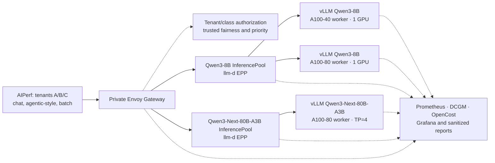

# Lambda two-model llm-d campaign

KIP validated two model pools and three synthetic tenants on a
three-node, non-HA Lambda cluster. `kubeadm` and Cilium joined an A10 control
plane to 1×A100-40 and 8×A100-80 workers; GPU Operator exposed whole GPUs.
KIP owned the pinned BF16 [vLLM model Deployments](deploy/lambda/models.json):
Qwen3-8B served chat, and Qwen3-Next-80B-A3B-Instruct served agentic-style
replay and batch. Envoy handled the private request entry point; llm-d handled
per-pool admission and endpoint selection.

The Gateway authenticated credentials and rejected spoofed scheduling headers;
each EPP controlled its own queue and chose an eligible vLLM endpoint. The
8B pool had two replicas to choose from; the 80B pool had one TP=4 replica on
four GPUs **within one node**, so its EPP mainly controlled when to dispatch.
Responses streamed back through the same private path. See the
[architecture](docs/architecture.md#lambda-two-model-campaign-paused-after-partial-validation)
for the component boundaries.

## Finding: the large pool was waiting before vLLM

AIPerf 0.12 replayed the same seeded, synthetic traces for all nine
tenant/class pairs over three matched text trials per setting. Only the large
pool EPP's `concurrency-detector.maxConcurrency` changed: **4 → 6 → 8**
in-flight requests. Queue capacity and its 60-second expiry did not change.

| Metric (three-trial mean) | Gate 4 | Gate 6 | Gate 8 |
| --- | ---: | ---: | ---: |
| Batch wait in llm-d EPP, P95 | 54.8 s | 29.0 s | **27.5 s** |
| Batch time to first token (TTFT), P95 | 45.9 s | 26.7 s | **21.0 s** |
| Agentic-style TTFT, P95 | 2.67 s | 1.69 s | 1.26 s |
| Chat TTFT, P95 | 0.211 s | — | 0.218 s |
| Infrastructure USD/success, listed-rate estimate | $0.008585 | — | $0.008348 |
