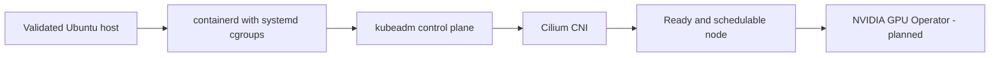
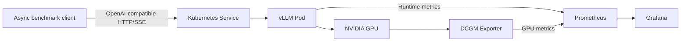

# v0.1 Architecture

Status: **Host and single-node cluster tooling implemented locally; not yet validated on target hardware**

The v0.1 milestone proves the smallest complete serving path on one SSH-accessible bare-metal NVIDIA GPU
server. The platform composes Kubernetes, NVIDIA's Kubernetes integration, and vLLM rather than
replacing them.

Before cluster bootstrap, `make host-setup` validates the supported Ubuntu/x86-64 contract and
installs only the tools required to inspect the machine. It does not install Kubernetes or
NVIDIA software. The same target-local entry point will later be reused by multi-node remote
orchestration.

The cluster bootstrap installs a pinned containerd runtime and creates one kubeadm node that
serves as both control plane and worker. kube-proxy provides the initial Kubernetes Service
implementation, while Cilium provides IPv4 pod networking through Kubernetes PodCIDR IPAM and
a VXLAN overlay. This conservative baseline keeps kube-proxy replacement, Hubble, multi-node
routing, and high availability as later measured changes rather than initial variables.

Bootstrap treats the following as one ordered dependency chain:

## Request path

The benchmark client sends OpenAI-compatible requests to a Kubernetes Service. The Service
selects the single vLLM replica, which performs continuous batching and executes inference on
the GPU. Streaming Server-Sent Events return generated content incrementally to the client.

## Telemetry path

Prometheus collects application-level metrics from vLLM and hardware-level metrics from DCGM
Exporter. Grafana visualises both perspectives. The benchmark client independently measures
time to first token, time per output token, end-to-end latency, and throughput.

## Platform boundary

The repository owns deployment configuration, experiment tooling, measurements, and the later
orchestration layer. Kubernetes owns workload scheduling, vLLM owns within-replica inference
scheduling and continuous batching, and NVIDIA's operators expose and monitor GPU hardware.

## Deferred components

The Go operator and gateway, authentication, rate limiting, multi-replica routing, autoscaling,
topology-aware placement, and multi-node distributed inference are intentionally outside the
v0.1 architecture. They will build on the measured baseline instead of being designed in
the absence of a working serving path.
