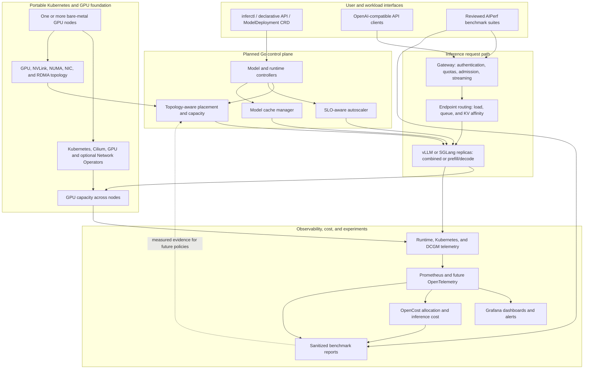
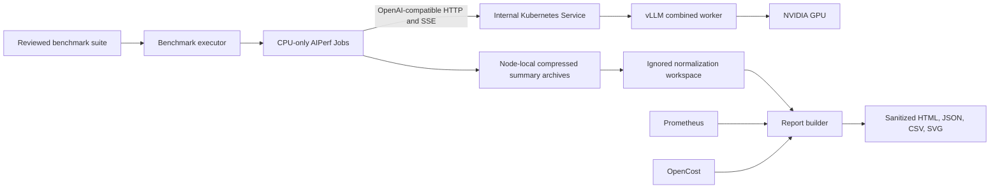
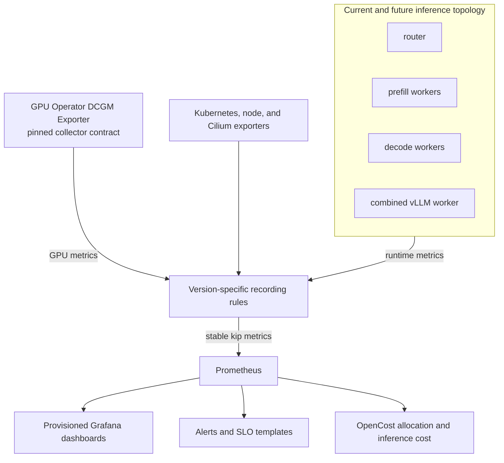

# Kube Inference Platform architecture

v0.1 status: **Host-to-inference validated on an NVIDIA A10 and again on a Vast RTX 4090;
live observability and a priced, reconciled short benchmark report are validated on the RTX 4090.
The five-trial baseline experiment remains pending.**

The v0.1 milestone proves a measurable and reproducible serving path on one SSH-accessible
bare-metal NVIDIA GPU server. The platform composes Kubernetes, NVIDIA's Kubernetes
integration, vLLM, Prometheus/Grafana, OpenCost, and AIPerf rather than replacing any of their
schedulers or accounting models.

## Eventual platform (planned)

The long-term goal is a portable, Kubernetes-native inference platform that turns one or more
supported, SSH-accessible bare-metal GPU servers into a model-serving cluster. A user should be
able to declare a model, runtime, GPU and parallelism needs, replica range, and latency target;
the platform should handle deployment, placement, request routing, scaling, health, measurement,
and cost. The same interface should work from one GPU through multi-node distributed replicas,
without tying the control plane to a particular server provider.



The control plane decides *what* should run and *where*: it translates `ModelDeployment`
resources into Kubernetes workloads, places GPU groups according to topology, and scales
replicas against inference SLOs. The gateway decides *whether* to admit a request and *which
replica* should receive it while forwarding streaming responses. The selected runtime retains
control of batching and token scheduling *inside* its replica.

Horizontal replicas and distributed execution solve different problems. The platform should
route among independent replicas for capacity and availability, while supporting tensor,
pipeline, and eventually disaggregated prefill/decode work within a replica when one model
needs multiple GPUs or nodes. Kubernetes-native workload primitives should manage distributed
replica lifecycles; the platform supplies topology and runtime configuration.

The measurement loop is a core platform feature: AIPerf exercises the same serving path as
clients, while Prometheus, DCGM, OpenCost, and future tracing provide the latency, throughput,
GPU, energy, and cost evidence used to compare routing, placement, and scaling policies. The
diagram is a destination, not a claim that its Go control plane, gateway, autoscaler, SGLang
adapter, or multi-node execution exists in v0.1.

## Bootstrap dependency chain

`make bootstrap` preserves the hard checkpoints between layers:

```mermaid
flowchart LR
    Host[Validated Ubuntu host] --> Runtime[containerd with systemd cgroups]
    Runtime --> ControlPlane[kubeadm control plane]
    ControlPlane --> CNI[Cilium CNI]
    CNI --> Ready[Ready and schedulable node]
    Ready --> GPUOperator[NVIDIA GPU Operator]
    GPUOperator --> GPUReady[Whole nvidia.com/gpu resource]
    GPUReady --> GPUSmoke[Temporary nvidia-smi Pod]
    GPUSmoke --> Dispatcher[Runtime dispatcher and committed profile]
    Dispatcher --> VLLM[vLLM Service]
    VLLM --> InferenceSmoke[OpenAI and streaming checkpoint]
    InferenceSmoke --> Observe[Prometheus, Grafana, DCGM, OpenCost]
    Observe --> AIPerf[AIPerf Kubernetes Job capability]
```



The composed command installs the AIPerf capability but does not start the exhaustive
baseline. A missing cost profile also does not prevent platform installation; it leaves the
stack explicitly unpriced and prevents benchmark publication.

Before cluster bootstrap, `make host-setup` validates the supported Ubuntu/x86-64 contract and
installs only inspection tools. Cluster bootstrap then installs pinned containerd/Kubernetes
components and creates one control-plane/worker node. kube-proxy supplies Service routing,
while Cilium provides IPv4 Pod networking through Kubernetes PodCIDR IPAM and VXLAN. Hubble,
kube-proxy replacement, multi-node routing, and high availability remain later changes.

## Serving and benchmark paths



The stable `runtime-*` commands resolve a committed runtime adapter and model profile. The
profile owns Kubernetes-generic identity, model, storage, and resources; the vLLM adapter owns
engine arguments, rendering, health, and OpenAI-compatible smoke tests. This avoids inventing a
premature common runtime implementation while keeping the public interface ready for a second
adapter.

The baseline profile deploys one BF16 Qwen2.5-7B-Instruct replica on one whole GPU and exposes
only a ClusterIP Service. A node-local hostPath cache survives Pod restarts; `Recreate` prevents
two full-GPU replicas from competing during updates. Health, exact model discovery,
non-streaming chat/legacy completion, and demonstrably incremental SSE are hard gates before
benchmarking.

AIPerf is the only traffic generator. KIP validates reviewed suites, creates ownership-safe
Kubernetes Jobs through an executor boundary, captures exact UTC run windows, normalizes
upstream results, fetches correlated telemetry and cost, and creates the report. It does not
duplicate AIPerf's async client or request-latency calculations. AIPerf 0.12 does not publish a
Kubernetes operator/CRDs, so v0.1 uses ordinary Jobs; a future operator can become another
executor without changing suite or report contracts.

## Stable telemetry contract



Runtime Pods identify `runtime`, `deployment`, `model_profile`, `served_model`,
`model_revision`, `worker_role`, replica, tensor-rank, and pipeline-rank. The Service is only
the discovery/routing boundary; Prometheus copies per-worker identity from the backing Pod so a
shared Service cannot falsely stamp every worker with rank zero. Prometheus enrichment also adds
cluster, namespace, Pod, node, and GPU UUID. The current Pod is `worker_role=combined`; future
`router`, `prefill`, and `decode` workloads supply their true per-Pod role and rank labels.

Dashboards query stable `kip:` recording rules rather than raw vLLM/DCGM metric names. The
adapter layer calculates request/error and token rates; server TTFT, TPOT, end-to-end, queue,
prefill, and decode percentiles; running/waiting requests; KV/prefix-cache state;
preemptions; readiness; GPU utilization/memory/power/thermal/clock/PCIe/XID state; and node
health. Dashboard variables filter these dimensions instead of hardcoding the v0.1 model or
Deployment. DCGM PCIe profiling is optional on GPUs that do not expose its profiling counters;
reports disclose missing series and render `N/A`, never a synthetic zero.

Collection has three deliberate resolutions: 5-second Prometheus samples for vLLM/DCGM,
15–30-second platform samples, and 333-millisecond AIPerf-local telemetry during an active
experiment. The fastest stream remains benchmark-local so long-term Prometheus storage does
not become a raw trace system.

Benchmark publication clips model-scoped stable runtime gauges and raw five-second DCGM GPU
gauges joined to the runtime Pod identity to each exact trial window for
queue, KV-cache, and GPU utilization, memory, power, temperature, PCIe,
clocks, throttle reasons, and XID state. It computes prompt/generated/cached token rates and
server TTFT/TPOT/end-to-end percentiles from the pinned vLLM counter and histogram increases
over that trial alone. The five-minute recording rules remain useful for dashboards but cannot
contaminate a benchmark cell with warmup, cooldown, or adjacent-cell traffic. AIPerf
summary-only output supplies reconciled success/error
counts plus client-observed TTFT and inter-token-latency (ITL) coverage. AIPerf ITL is kept
distinct from vLLM's server TPOT, which comes from
`vllm:request_time_per_output_token_seconds_bucket`. This is reported as streaming timing
evidence, not an SSE protocol proof. The runtime smoke test remains responsible for
incremental arrival and terminal `[DONE]` validation.

## Cost model

The pricing source is a reviewed profile under `costs/profiles/`, not cloud credentials. A
v0.1 profile declares a positive USD whole-node hourly price, provider/SKU/region, source,
effective date, physical GPU count, and that power is included. Its canonical hash is carried
into the report.

For a dedicated homogeneous node:

```text
OpenCost GPU hourly rate = whole-node hourly rate / physical GPU count
CPU, RAM, storage, network, and load-balancer rates = 0
```

This avoids charging the same rental twice. The **allocated** view shares node-local idle cost
and is the bill-reconciling primary measure. The **usage** view excludes idle allocation and
shows active efficiency. DCGM power integration reports Wh/request and kWh/million tokens but
does not add an electricity charge already included in the rental.

For each benchmark, `hourly rate × experiment elapsed time` is the audit total. OpenCost
attributes runtime, idle, and future shared infrastructure by model/workload labels. A report
is valid only when allocated cost reconciles within the greater of 5% or one minute of node
cost and when inference token attribution is present. These numbers are transparent estimates,
not provider invoices.

## Persistence and trust boundaries

Prometheus, Grafana, Alertmanager, and AIPerf results use project-owned node-local storage.
OpenCost remains an internal API over Prometheus data. All platform services are ClusterIP and
normal administration occurs through SSH plus loopback-only `kubectl port-forward` sessions.

Benchmark Jobs run in `kip-benchmark` through a scoped ServiceAccount and request no GPU. The
20-GiB PV maps the fixed node path `/var/lib/kube-inference-platform/benchmark-results`.
AIPerf exports aggregate summaries only, and each successful cell is retained there as a
compressed archive before being copied into ignored `benchmarks/.work/` for normalization.
Failure diagnostics also remain ignored. Only sanitized HTML, SVG, JSON, CSV, and a
reproducibility manifest under `benchmarks/reports/` are eligible for version control.

The repository owns deployment configuration, stable metric adapters, reviewed suites,
pricing provenance, orchestration, and reports. Kubernetes owns workload scheduling, vLLM
owns continuous batching, NVIDIA components expose GPU capacity/telemetry, AIPerf owns load
generation and request metrics, Prometheus owns time-series collection, and OpenCost owns
allocation/inference-cost attribution.

## GPU boundary and deferred components

GPU Operator uses the classic ClusterPolicy/Device Plugin path. CDI supplies whole devices to
ordinary Pods without a runtime class. Operator-managed drivers are the default; host drivers
are accepted only through explicit preinstalled mode. Capacity must match physical display
PCI devices and a temporary digest-pinned CUDA Pod must execute `nvidia-smi` before runtime
deployment.

MIG, time sharing, DRA, GPUDirect, heterogeneous node pricing, component-level price models,
automatic provider billing ingestion, currency conversion, carbon accounting, Loki, Tempo,
OpenTelemetry tracing, Hubble, remote metrics storage, high-availability Prometheus, public
report hosting, Grafana image rendering, benchmark scheduling, accuracy evaluation, arbitrary
runtime overrides, the Go operator/gateway, authentication, autoscaling, and multi-node
distributed inference remain outside v0.1.
